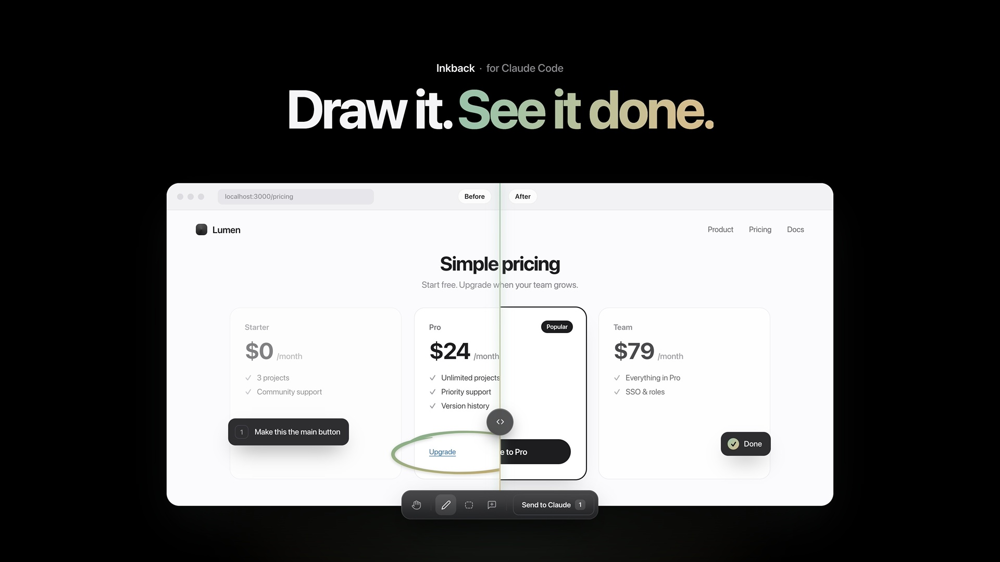

# Inkback

**Mark what's wrong on your running app, and get proof of what Claude changed, including what you didn't ask for.**

For people building with Claude Code in the terminal or VS Code. Local, no account.

<!-- GIF goes here (30 s, real run): mark a button, Claude fixes it, Inkback catches the footer it broke, one click sends it back. Save as assets/inkback-demo.gif and replace the hero image line below with:

-->


## Install

```text
/plugin marketplace add petertrawka/inkback
/plugin install inkback@inkback
```

Then, with your app running, run `/inkback:review http://localhost:3000` in Claude Code. No special flags.

**Limits:** Google Chrome and Node 20+ only. Local addresses only (localhost, 127.0.0.1, *.local, *.test).

## What it does

Comment and sketch right on the page, press **Send to Claude**, and Claude edits the code. When it's done, every note comes back marked *Changed*, *No visible change* or *Couldn't check*, with a before/after slider, and anything else on the page that changed shows up under *Also changed*.

- **Comment anywhere.** Double-click to leave a note. Paste or drop up to 4 reference images into it.
- **Ink brush pen.** Strokes thin out when you draw fast and taper at both ends, in a sage-to-gold gradient. Every stroke opens a linked comment.
- **Spotlight areas** (key `A`). Drag a box and the rest of the page dims while you write.
- **Send to Claude.** Your notes, the element under each one (with its React component and source file when known) and screenshots land in your Claude Code session.
- **Before / after.** When Claude finishes, each spot comes back with a slider. The "after" picture follows the element even if content above it moved.
- **Also changed.** After each round Inkback compares the whole page. Areas that changed away from your notes are boxed and listed, each with its own slider.
- **Two endings.** *Looks good, close* ends the round and closes the window. *More feedback* reloads the page for another round.
- **Not right.** Every result (asked-for or "Also changed") has a *Not right* button. Press it on as many as you like: the next round starts with a ready-made note on each spot, "Put this back the way it was", with the before picture attached. Edit the text or add more notes, then Send as usual.
- **Local only.** It runs on your machine in its own Chrome window. No cloud, and no AI calls beyond your Claude session.

## How to use it

With your app running, start Claude Code as usual (no special flag) and run:

```text
/inkback:review http://localhost:3000
```

Claude says it is waiting. Draw, add notes, press **Send to Claude**, and Claude edits your code.

Optional speed-up: start Claude Code with `claude --dangerously-load-development-channels plugin:inkback@inkback` and add `--push` to the command. Notes then arrive instantly instead of through the waiting loop. You never need this.

## Credits

Inkback is built on [claude-annotate](https://github.com/FinalAngel/claude-annotate) by Angelo Dini, released under the MIT licence. The browser bridge, element context and Send loop are his. Inkback adds its own look, pen, spotlight areas and before/after review.
MIT licence, see [LICENSE](LICENSE).
